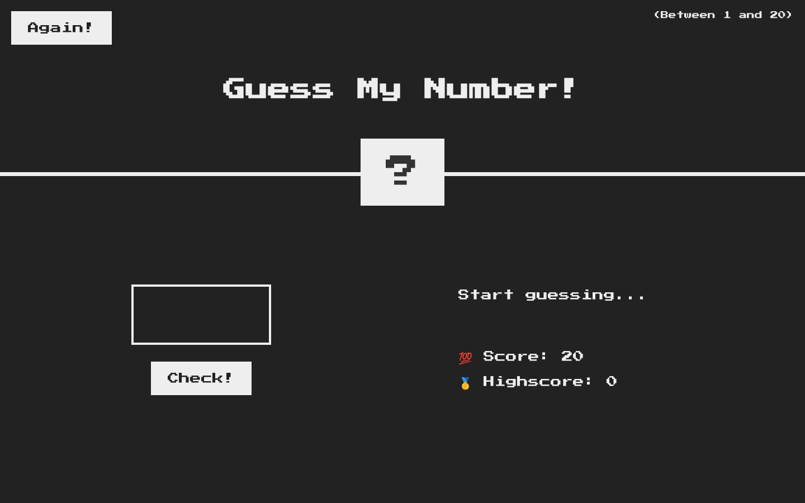
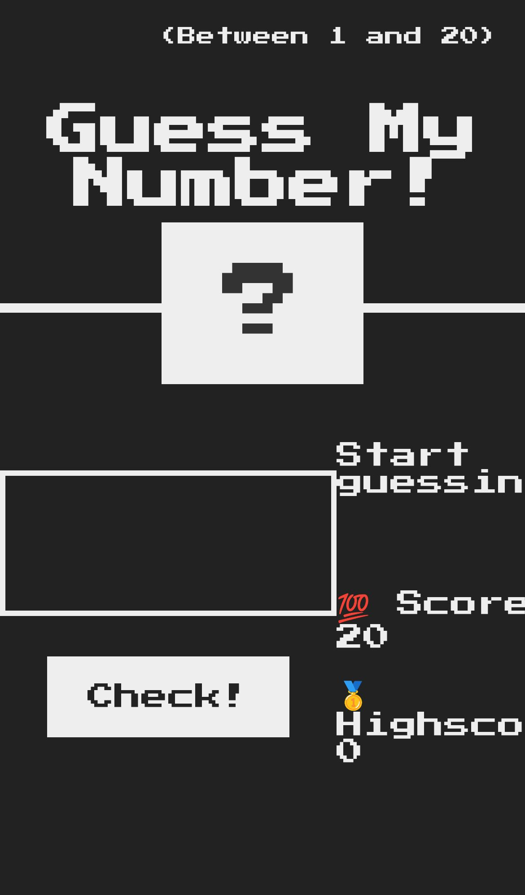

<div align="center">

# Guess My Number!

### A tiny retro number-guessing game in vanilla JavaScript

Guess the secret number between 1 and 20. Every wrong guess costs a point, and your best score is kept as the high score until you reload the page.

[](https://developer.mozilla.org/docs/Web/HTML)
[](https://developer.mozilla.org/docs/Web/CSS)
[](https://developer.mozilla.org/docs/Web/JavaScript)
[](https://getbootstrap.com)
<br>
[](https://eslamraafat1.github.io/Guess-My-Number/)

**[Live demo](https://eslamraafat1.github.io/Guess-My-Number/)** ·
**[Portfolio](https://new-portfolio-ashy-xi.vercel.app/)** ·
**[LinkedIn](https://www.linkedin.com/in/eslamraafat-dev/)** ·
**[Email](mailto:eslamraafat736@gmail.com)**

<br>



</div>

<table>
  <tr>
    <td width="33%"></td>
    <td width="67%" valign="top">
      <b>How to play</b>
      <ol>
        <li>Type a number from 1 to 20 and press <b>Check!</b></li>
        <li>The game tells you if your guess is <i>too high</i> or <i>too low</i>, and takes a point off your score.</li>
        <li>Guess right and the page turns green, the secret number is revealed and your score can become the new high score.</li>
        <li>Press <b>Again!</b> to start a new round with a new secret number.</li>
      </ol>
    </td>
  </tr>
  <tr>
    <td align="center"><sub>Mobile (iPhone 13)</sub></td>
    <td align="center"><sub>Game rules</sub></td>
  </tr>
</table>

---

## Overview

A small **practice project** from my front-end training (2023). It is a classic beginner JavaScript exercise, and I used it to practise the basics of DOM work: selecting elements, handling click events, reading input values, updating text and styles from code, and keeping simple game state in variables.

It is a single static page with no build step and no dependencies to install.

## Features

- **Random secret number** from 1 to 20, generated with `Math.random()` at the start of every round.
- **Hints** after each guess: "too high!", "too low!", a special message for numbers above 20, and a warning when the input is empty.
- **Score** starts at 20 and drops by one for every wrong guess.
- **High score** is updated when you win with a score equal to or higher than the current one. It lasts for the session (it is not saved to storage).
- **Win state:** the background turns green, the hidden number is shown and the **Check!** button is disabled until you start again.
- **Again!** resets the score, the message, the input, the colours and picks a new number, while keeping the high score.
- Retro look with the **Press Start 2P** Google Font.

## Tech stack

| Layer | Tools |
| --- | --- |
| Markup | HTML5 |
| Styling | CSS3 (`style.css`), Bootstrap 5.2.3 (bundled locally), Google Fonts (Press Start 2P) |
| Logic | Vanilla JavaScript (`script.js`, strict mode) |
| Formatting | Prettier (`.prettierrc`) |
| Hosting | GitHub Pages |

## Project structure

```text
.
├── index.html               # game markup
├── style.css                # layout and retro styling
├── script.js                # game logic: guess, hints, score, high score, reset
├── bootstrap-5.2.3-dist/    # local copy of Bootstrap 5.2.3 (CSS + JS)
├── .prettierrc              # code formatting settings
└── docs/screenshots/        # images used in this README
```

## Getting started

No install is needed. Clone the repo and open `index.html` in a browser, or serve the folder:

```bash
git clone https://github.com/Eslamraafat1/Guess-My-Number.git
cd Guess-My-Number
npx serve .        # or just open index.html
```

## Deployment

The game is deployed on **GitHub Pages** from the `master` branch: [eslamraafat1.github.io/Guess-My-Number](https://eslamraafat1.github.io/Guess-My-Number/).

## Author

**Eslam Raafat**, Front-End Developer (React · Next.js · TypeScript)

- **Portfolio:** [new-portfolio-ashy-xi.vercel.app](https://new-portfolio-ashy-xi.vercel.app/)
- **LinkedIn:** [linkedin.com/in/eslamraafat-dev](https://www.linkedin.com/in/eslamraafat-dev/)
- **GitHub:** [@Eslamraafat1](https://github.com/Eslamraafat1)
- **Email:** [eslamraafat736@gmail.com](mailto:eslamraafat736@gmail.com)
